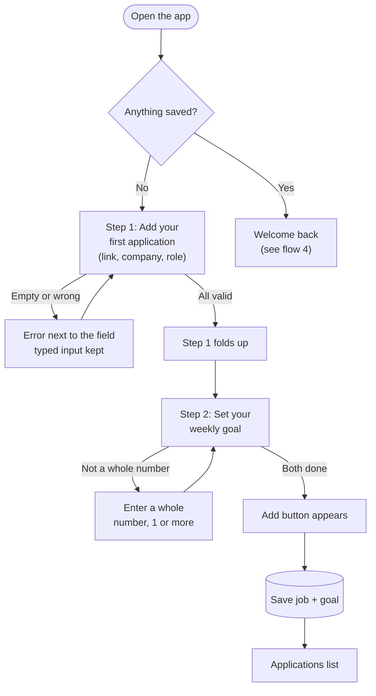
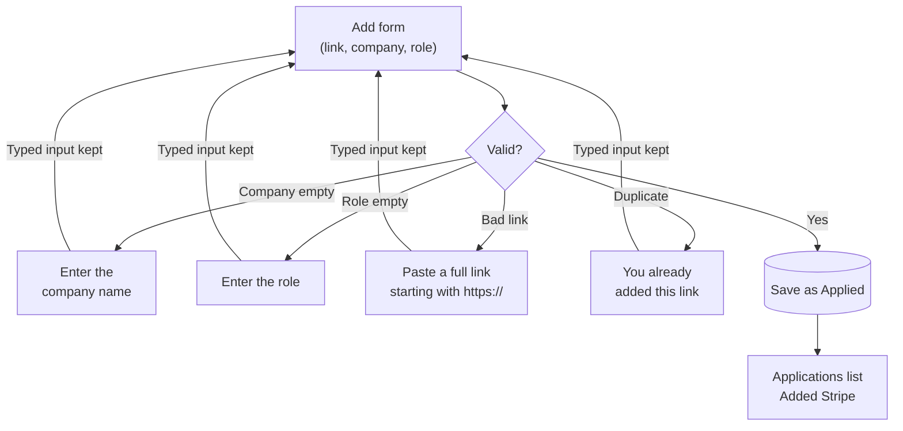
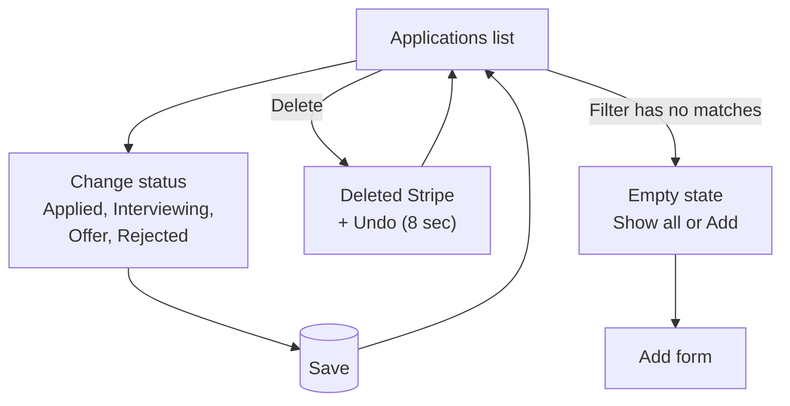
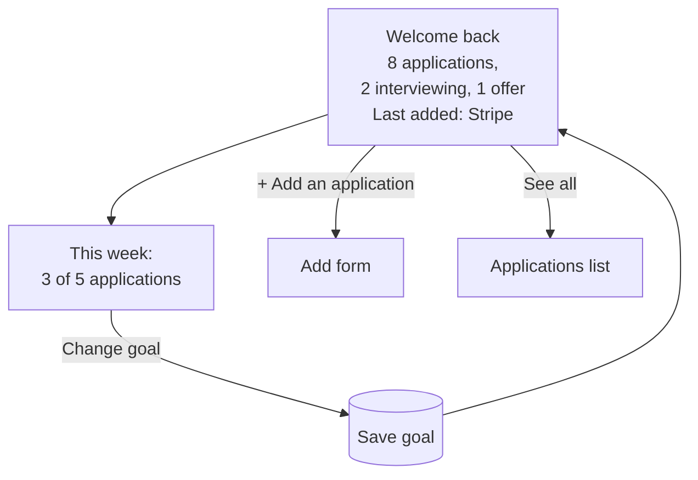

# Job Application Tracker

MPCS 51238 Design, Build, Ship · Assignment 3: Patterns & Flows

A small tool for anyone job hunting. Paste a job link, add the company and role, and keep track of where each application stands. Everything is saved in your browser (localStorage), so it's still there when you come back.

**Live:** https://mpcs-design-build-ship-3.vercel.app/

## Flows

**Main task:** I paste a job link and add the company and role → it's on my applications list as "Applied" → whenever I come back, all my applications are still there, with their latest status.

**1. First visit: two-step onboarding**



**2. Add a job (/add)**



**3. The list (/applications)**



**4. Coming back (/)**



Full flow notes, states, and errors: [flows.md](flows.md)

## Onboarding research

Three subagents studied how similar tools welcome someone new (public pages, help centers, and reviews; no accounts created).

| | Huntr | Teal | Simplify |
|---|---|---|---|
| **First screen** | "Less Hassle, More Interviews" + sign-up; no demo | Resume-first landing; "Try a demo" on tracker page | "Your AI Job Search Partner"; dashboard of matches, goals, streaks |
| **What it asks for** | Account (reportedly LinkedIn + target job) | Account + goals survey (target title, timeline) | Account + resume/profile + job preferences |
| **Time to first saved job** | ~4 steps; must pick a board and list first | ~4 steps; tracker **pre-filled with sample jobs** | ~4–6 steps; long profile setup first |
| **Add-job form** | Company, title, board, list; pasted link fills nothing | Title, URL, company, location, description; pasted link fills nothing | Role, company, location, status; CSV import needs only company + title |
| **Reasons to return** | Due/overdue activities | Weekly goals, follow-up dates | Streaks, weekly application goal, match emails |

**Pattern:** all three put an account and setup before anything useful happens.

**What I'm using:**
- **Learn by doing:** the first visit *is* your first save. Two numbered steps: (1) add your first application, which folds up once it's valid, and (2) set your weekly goal, then **Add**. No tour and no blank screen.
- **Minimal form (from Simplify/Huntr):** only link, company, and role; status starts at Applied. Nothing else asked before the first save.
- **Weekly goal (from Simplify/Teal):** set during onboarding, then shown as "3 of 5 applications this week" on every return: a reason to come back without accounts or email.
- **Tried and dropped: sample jobs (from Teal).** The first version showed 3 labelled example jobs. I removed them: they were extra things to read and clear, and they made the counts confusing (first-run issue 4). Adding your own first job is more useful right away.
- **Avoiding:** sign-up walls, setup surveys, and choosing a board/list before saving.

## Accessibility

Checked with the agent:

- **Contrast (WCAG AA):** body text 15.9:1, hints and secondary text 7.0:1, error text 7.0:1, current nav link 6.3:1, primary button 15.9:1, the filled "+ Add" nav button 6.3:1, and the terracotta numbers in the welcome back summary 6.6:1. Input, select, and filter borders were 1.4:1 at first; darkened to `#8c7f6c` (3.6:1+) to meet the 3:1 rule for form controls.
- **Labels:** every field has a real `<label>`; hints and errors are linked with `aria-describedby`, and invalid fields get `aria-invalid`. Status dropdowns are named per job ("Status for Stripe, Product Designer").
- **Keyboard:** skip link, visible focus ring everywhere, the full add flow works with Tab and Enter, and on an error focus moves to the first field that needs attention.
- **Onboarding:** each step is a `<fieldset>` whose legend is read as "Step 1: Add your first application"; a done step is announced as "(done)", and the "Both steps done" + Add area is a polite live region. Enter moves through the steps even before the Add button appears.
- **Automated audit:** axe-core (WCAG 2.1 A/AA + best practices) on onboarding (empty, with errors, ready), the add form, list, empty filter, welcome back, and goal editor: no violations.

## First-run check

### Round 1 (first deploy)

After deploying, a fresh agent (no access to the code or this conversation) used the live site in headless Chrome as a brand-new job hunter. Goal: *"Add three jobs you applied to this week, then come back later and check on them."* It made natural mistakes on purpose, tried the keyboard, a phone viewport, and returned with the same saved data.

**What worked:** the purpose and first action were clear within seconds, and "No sign-up" built trust. Errors were specific, kept what was typed, and moved the cursor to the field to fix. Pasting a link and landing on a form with it prefilled felt fast. Examples were clearly labelled; filter chips and empty states helped. Data persisted on return and the keyboard-only add worked.

**What it found, and what I did:**

| # | Issue | Severity | Change |
|---|---|---|---|
| 1 | No way to edit or delete your own jobs; a mistaken add stays forever | High | **Fixed:** Delete on each card, with an Undo bar for 8 seconds. (Edit left out for simplicity.) |
| 2 | Cards don't show when you applied; returning tells you nothing new | Medium | **Fixed:** each card shows "Added 6 days ago". (No follow-up nudges: out of scope.) |
| 3 | Duplicate link only caught after filling the whole form; "Find it in Applications" wasn't a link | Medium | **Fixed:** checked as soon as the link is pasted, with a link to the saved job, which is highlighted |
| 4 | Applications said "All 4" while Home said "1 application" (examples counted) | Medium | **Fixed:** examples are removed automatically when you add your first real job. *(Later: examples removed entirely, see Design changes.)* |
| 5 | `stripe.com/jobs` rejected instead of fixed | Low | **Fixed:** `https://` is added automatically to bare addresses |
| 6 | Faint focus ring on dark buttons | Low | **Fixed:** 3px outline with a 3px gap |
| 7 | Filter resets on reload or Back | Low | Not changed (kept simple) |
| 8 | "+ Add" wraps on phones | Low | **Fixed:** tighter nav that never wraps |
| 9 | Plain 404 page | Low | Not changed |

**What I learned:** the flows held up, but the agent spotted gaps I had cut for simplicity (deleting) that turn out to be essential, and inconsistencies (example counts) I'd stopped noticing. Testing as a stranger caught things my own scripted tests didn't.

### Round 2 (after the onboarding rebuild)

Same setup with a new fresh agent and a new goal: *"Get set up, add three jobs you applied to this week, then come back later and check on them."*

**What worked:** the two-step setup was clear within seconds, and "an Add button will appear here" explained how to finish. Errors sat next to their fields and kept what was typed. A link without `https://` was fixed instead of rejected. Delete with Undo, the empty filter state, and the return screen were easy to use ("the Add button is hard to miss"). Setup worked with only the keyboard, the phone layout held up, and there were no console errors.

**What it found, and what I did:**

| # | Issue | Severity | Change |
|---|---|---|---|
| 1 | Clicking "+ Add" again opened the form still filled with the previous job | High | **Fixed (bug).** Next.js 16 (`cacheComponents`) keeps recently visited pages alive and restores their React state. The form now resets after a successful save. An unsaved draft is still kept if you leave midway. |
| 2 | After a second add, the banner said "Added" with the *previous* job, or showed nothing | High | **Fixed (bug).** Same cause. The banner and highlight now follow each new save and clear when you leave the page. |
| 3 | "You're all set" showed before anything was saved | Medium | **Fixed:** now reads "Both steps done. Press Add to save." The button stays **Add**. |
| 4 | A goal of 9999 was accepted | Low | Not changed: no upper limit is a deliberate choice |
| 5 | The summary leaves out rejections | Low | Not changed |
| 6 | After saving, keyboard focus landed on the page body | Low | **Fixed:** focus moves to the "Added …" confirmation |

**What I learned:** my own scripted tests loaded each page fresh, so they never caught bugs 1 and 2. The tester moved around the site the way a person does, without reloading, and that's what exposed them. I added a regression test that does four adds in a row using only in-app navigation.

## Design changes after round 1

- **Onboarding rebuilt:** example jobs removed. The first visit is now two numbered steps, *Add your first application* (folds up automatically once the link, company, and role are valid) and *Set your weekly application goal* (any whole number, no upper limit), followed by an **Add** button that appears when both are done.
- **Welcome back:** the paste-link field is gone. Instead there's a prominent **+ Add an application** button, and "+ Add" in the navigation is now a filled terracotta button on every page. The summary ("1 application · 0 interviewing · 0 offers", "Last added: DT42 AI, today") is larger, in ink, with the numbers and company in terracotta, on a card with an accent edge.

## Run locally

```bash
npm install
npm run dev
```

Built with Next.js and Tailwind CSS. No database, accounts, or external APIs.
