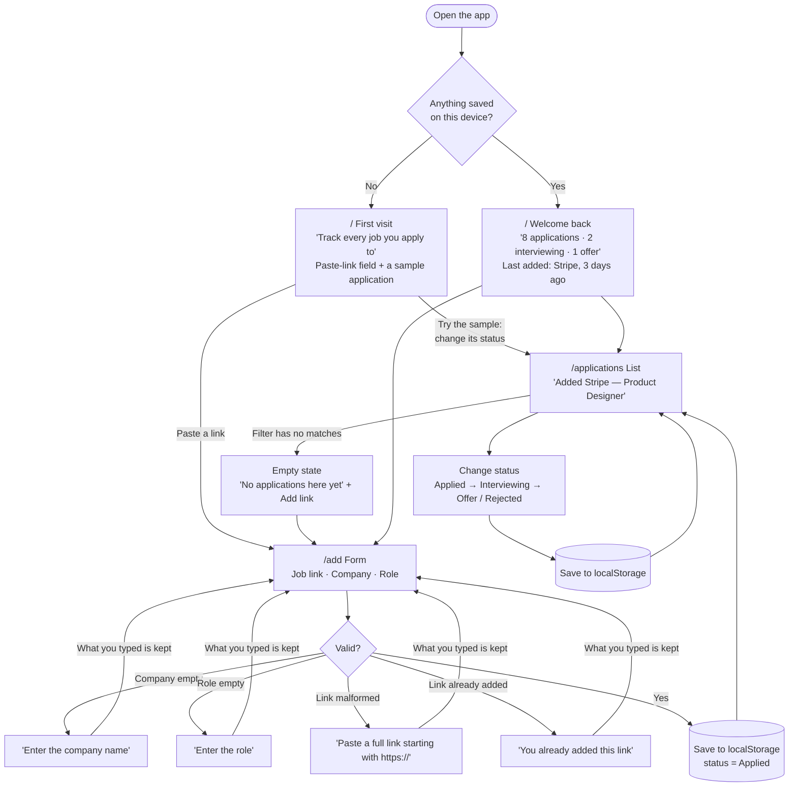

# Job Application Tracker

MPCS 51238 Design, Build, Ship · Assignment 3: Patterns & Flows

A small tool for anyone job hunting. Paste a job link, add the company and role, and keep track of where each application stands. Everything is saved in your browser (localStorage), so it's still there when you come back.

**Live:** _coming soon (Vercel)_

## Flows

**Main task:** I paste a job link and add the company and role → it's on my applications list as "Applied" → whenever I come back, all my applications are still there, with their latest status.



Full flow notes, states, and errors: [flows.md](flows.md)

## Onboarding research

_Coming in step 3._

## First-run check

_Agent usability feedback goes here after deploy._

## Run locally

```bash
npm install
npm run dev
```

Built with Next.js and Tailwind CSS. No database, accounts, or external APIs.
