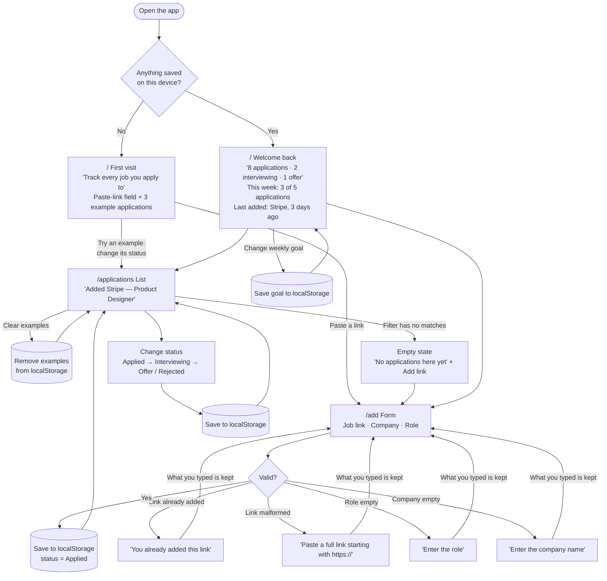

# Job Application Tracker

MPCS 51238 Design, Build, Ship · Assignment 3: Patterns & Flows

A small tool for anyone job hunting. Paste a job link, add the company and role, and keep track of where each application stands. Everything is saved in your browser (localStorage), so it's still there when you come back.

**Live:** _coming soon (Vercel)_

## Flows

**Main task:** I paste a job link and add the company and role → it's on my applications list as "Applied" → whenever I come back, all my applications are still there, with their latest status.



Full flow notes, states, and errors: [flows.md](flows.md)

## Onboarding research

Three subagents studied how similar tools welcome someone new (public pages, help centers, and reviews; no accounts created).

| | Huntr | Teal | Simplify |
|---|---|---|---|
| **First screen** | "Less Hassle, More Interviews" + sign-up; no demo | Resume-first landing; "Try a demo" on tracker page | "Your AI Job Search Partner"; dashboard of matches, goals, streaks |
| **What it asks for** | Account (reportedly LinkedIn + target job) | Account + goals survey (target title, timeline) | Account + resume/profile + job preferences |
| **Time to first saved job** | ~4 steps; must pick a board and list first | ~4 steps; tracker **pre-filled with sample jobs** | ~4–6 steps; long profile setup first |
| **Add-job form** | Company, title, board, list; pasted link fills nothing | Title, URL, company, location, description; pasted link fills nothing | Role, company, location, status; CSV import needs only company + title |
| **Reasons to return** | Due/overdue activities | Weekly goals, follow-up dates | Streaks, weekly application goal, match emails |

**Pattern:** all three put an account and setup before anything useful happens.

**What I'm using:**
- **Sample jobs (from Teal):** the first visit shows 3 labelled example applications, one per status, so the list is never empty and you learn by changing a status. A "Clear examples" button removes them.
- **Minimal form (from Simplify/Huntr):** only link, company, and role; status starts at Applied. Nothing asked before the first save.
- **Weekly goal (from Simplify/Teal):** "3 of 5 applications this week" in the welcome back summary, a reason to return without accounts or email.
- **Avoiding:** sign-up walls, setup surveys, and choosing a board/list before saving.

## First-run check

_Agent usability feedback goes here after deploy._

## Run locally

```bash
npm install
npm run dev
```

Built with Next.js and Tailwind CSS. No database, accounts, or external APIs.
