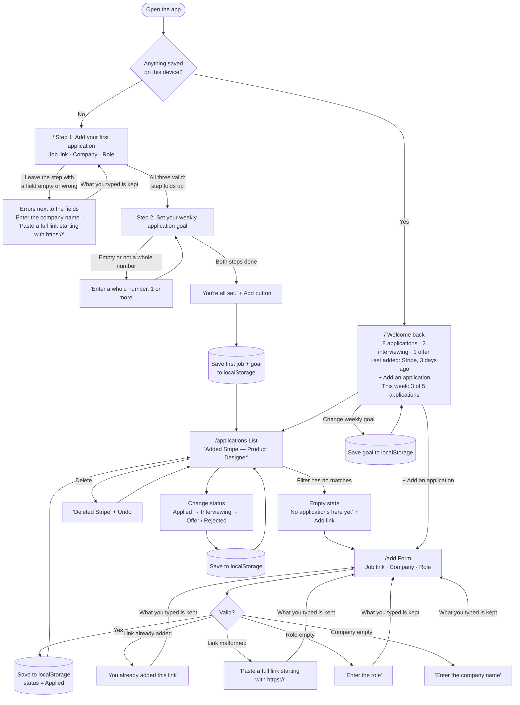

# Flows

**Main task:** I paste a job link and add the company and role → it's on my applications list as "Applied" → whenever I come back, all my applications are still there, with their latest status.

## Pages

| Route | Step | What's on it |
|---|---|---|
| `/` | First visit / Welcome back | New: two short steps. (1) Add your first application: job link, company, role; it folds up once all three are valid. (2) Set your weekly application goal. When both are done, an **Add** button finishes onboarding. Returning: a "Welcome back" summary of your progress, a prominent **+ Add an application** button, your weekly goal, and your most recent jobs. |
| `/add` | The form | Job link, Company, Role in one column. Status starts as Applied. |
| `/applications` | The list | Every application, each with a status you can change. |

Shared navigation on every page: **Home · Applications · + Add** (the Add link is a filled button so it's always easy to find).

## Diagram

## States and errors kept

- **First visit (onboarding):** never a blank screen. Two numbered steps:
  1. **Add your first application:** job link, company, role. A bad link is flagged as soon as you leave the field; leaving the step with something missing shows every error next to its field. Once all three are valid and you move on (Tab, click, or Enter), the step folds up to a one-line summary with **Edit**.
  2. **Set your weekly application goal:** any whole number, 1 or more (no upper limit).
  When both are done, "You're all set." and an **Add** button appear; Add saves both and opens your list. Enter moves through the steps, so it all works by keyboard.
- **Empty state:** a filter with no matches explains itself and links to Add.
- **Form errors** (placed next to the field, typed input kept):
  - "Enter the company name"
  - "Enter the role"
  - "Paste a full link starting with https://"
  - "You already added this link"
- **Status:** Applied → Interviewing → Offer / Rejected, saved on change.
- **Delete** (added after the first-run check): removes a job, with Undo for 8 seconds. Each card shows when it was added.
- **Links:** bare addresses like `stripe.com/jobs/1` get `https://` added; duplicates are caught as soon as the link is pasted.
- **Coming back:** applications, statuses, and the goal are remembered on this device. Home shows "Welcome back." with a highlighted summary (counts and the last company in terracotta), a prominent **+ Add an application** button, the weekly goal, and the 3 most recent jobs.
- **Weekly goal:** "3 of 5 applications this week" (week starts Monday, set during onboarding, changeable on the home page, no upper limit). Saved locally.

Considered and dropped (simplicity): a "followed up" button, notes, editing, a 7-day "gone quiet" banner. Example jobs on the first visit were tried and then removed: adding your own first job is more useful than playing with fake ones. The paste-link field on the returning home page was replaced by the **+ Add** button.
