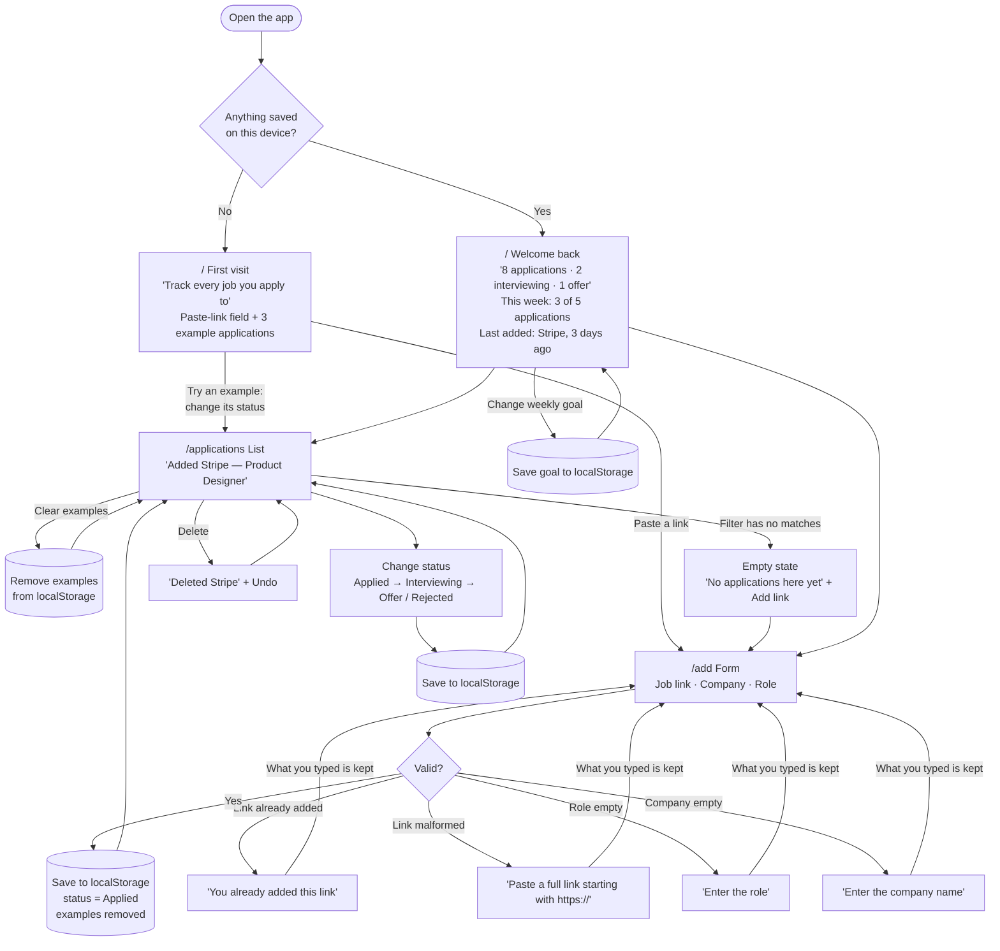

# Flows

**Main task:** I paste a job link and add the company and role → it's on my applications list as "Applied" → whenever I come back, all my applications are still there, with their latest status.

## Pages

| Route | Step | What's on it |
|---|---|---|
| `/` | First visit / Welcome back | New: what the tool is for, a paste-link field, and 3 example applications (one per status) you can try, with a "Clear examples" button. Returning: a "Welcome back" summary of your progress and your weekly goal. |
| `/add` | The form | Job link, Company, Role in one column. Status starts as Applied. |
| `/applications` | The list | Every application, each with a status you can change. |

Shared navigation on every page: **Home · Applications · + Add**.

## Diagram

## States and errors kept

- **First visit:** 3 clearly labelled example applications (Applied, Interviewing, Offer) and a paste-link prompt, never a blank list. "Clear examples" removes them, and they're removed automatically when you add your first real job. Examples don't count toward the weekly goal.
- **Empty state:** a filter with no matches explains itself and links to Add.
- **Form errors** (placed next to the field, typed input kept):
  - "Enter the company name"
  - "Enter the role"
  - "Paste a full link starting with https://"
  - "You already added this link"
- **Status:** Applied → Interviewing → Offer / Rejected, saved on change.
- **Delete** (added after the first-run check): removes a job, with Undo for 8 seconds. Each card shows when it was added.
- **Links:** bare addresses like `stripe.com/jobs/1` get `https://` added; duplicates are caught as soon as the link is pasted.
- **Coming back:** applications and statuses are remembered on this device, and the home page shows a welcome back summary.
- **Weekly goal:** "3 of 5 applications this week" (week starts Monday, default goal 5, changeable on the home page). Saved locally.

Considered and dropped (simplicity): a "followed up" button, notes, editing, a 7-day "gone quiet" banner.
